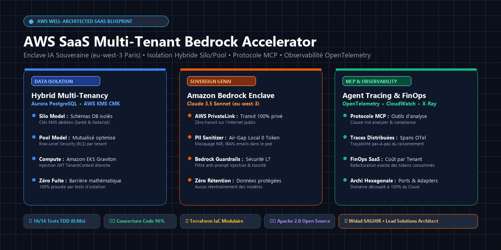
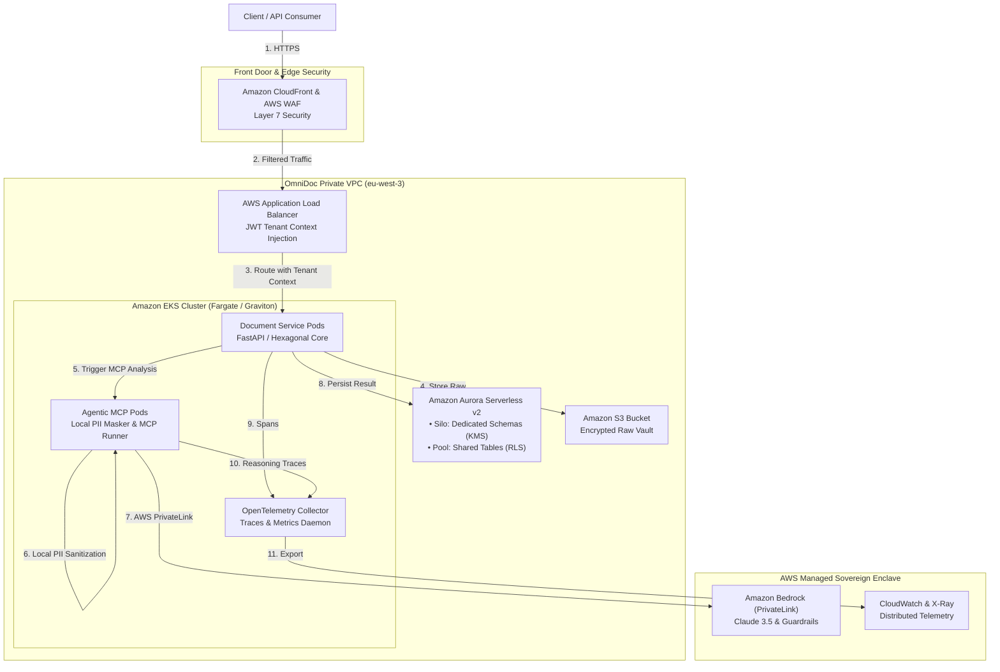
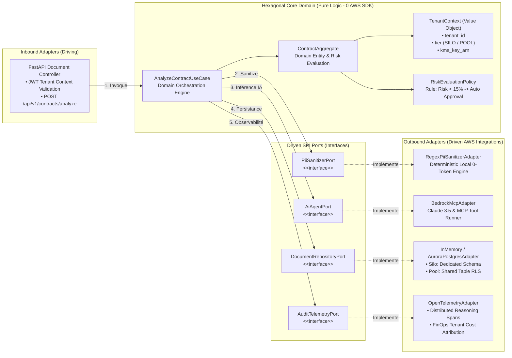
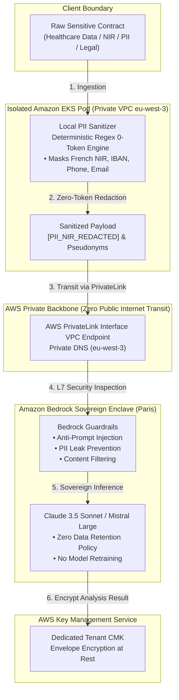

# 🚀 AWS SaaS Multi-Tenant Bedrock Accelerator
### *Production-Ready Multi-Tenant Architecture with Hybrid Isolation (Silo/Pool), Hexagonal Design, Model Context Protocol (MCP), and OpenTelemetry Observability*

[](https://github.com/widadsaghir/aws-saas-multi-tenant-bedrock-accelerator)
[](https://www.python.org/)
[-orange?style=for-the-badge&logo=amazon-aws)](https://aws.amazon.com/)
[](#architecture-patterns)
[-brightgreen?style=for-the-badge)](#testing--verification)

<p align="center">
  
</p>

---

## 📌 Executive Summary

Modern Independent Software Vendors (ISVs) transitioning from legacy single-tenant architectures to Cloud-Native SaaS face three critical hurdles:
1. **Data Confidentiality & Regulatory Constraints:** Highly regulated clients (Healthcare, Legal, Banking) refuse shared database models and demand sovereign, isolated cryptographic boundaries.
2. **Safe Generative AI Integration:** Enterprises require guarantee that sensitive client data never trains foundation models and that prompt injections are blocked before reaching domain layers.
3. **Agentic Non-Determinism in Production:** Orchestrating autonomous agents without granular execution observability leads to unpredictable runtimes and untraceable failures.

**`aws-saas-multi-tenant-bedrock-accelerator`** solves these challenges by providing an open-source, reference enterprise blueprint combining **Hybrid Multi-Tenancy (Silo DB / Pool Compute)**, **Hexagonal Architecture (Ports & Adapters)**, **Zero-Trust Sovereign AI Enclaves (Amazon Bedrock in `eu-west-3`)**, and **OpenTelemetry distributed reasoning traces**.

---

## 🏛️ Architecture Highlights

```
┌─────────────────────────────────────────────────────────────────────────────────────────────────┐
│                           CORE ARCHITECTURAL PILLARS (AWS WELL-ARCHITECTED)                     │
├────────────────────┬────────────────────────────────────────────────────────────────────────────┤
│ Hybrid Isolation   │ • Silo Model : Dedicated Aurora schema & AWS KMS Customer Managed Key (CMK)│
│                    │ • Pool Model : Shared table partition with PostgreSQL Row-Level Security   │
│                    │ • Compute : Shared Amazon EKS (Graviton) with JWT Tenant Context           │
├────────────────────┼────────────────────────────────────────────────────────────────────────────┤
│ Sovereign AI (MCP) │ • Model Context Protocol (MCP) tool integration for autonomous agents      │
│                    │ • Amazon Bedrock Claude 3.5 Sonnet / Mistral hosted in Paris (eu-west-3)   │
│                    │ • Zero-Trust Local PII Redaction (0 token cost) before network egress      │
│                    │ • AWS PrivateLink VPC Endpoint : 100% private transit (Zero Public Web)   │
├────────────────────┼────────────────────────────────────────────────────────────────────────────┤
│ Observability      │ • Distributed OpenTelemetry spans capturing every agent reasoning step     │
│                    │ • CloudWatch & AWS X-Ray export with tenant_id correlation dimension       │
├────────────────────┼────────────────────────────────────────────────────────────────────────────┤
│ FinOps SaaS        │ • Unit Cost per Tenant tracking (infrastructure & token inference billing) │
├────────────────────┼────────────────────────────────────────────────────────────────────────────┤
│ Craftsmanship      │ • 100% Deterministic TDD test suite running in < 2 seconds without AWS fee│
└────────────────────┴────────────────────────────────────────────────────────────────────────────┘
```

---

## 📐 C4 Architecture Diagrams

### 1. C1 — System Context Diagram
```mermaid
flowchart TD
    subgraph Users [Users]
        UserRegulated["Regulated Users<br/>(Healthcare & Legal)"]
        UserSME["Standard Users<br/>(B2B SMEs)"]
    end

    OmniDoc["OmniDoc SaaS Platform<br/>Multi-Tenant Document Automation<br/>& Sovereign Agentic AI"]

    subgraph AWS_Cloud [AWS Paris Region (eu-west-3)]
        Bedrock["Amazon Bedrock<br/>Claude 3.5 Sonnet & Guardrails"]
        KMS["AWS KMS<br/>Dedicated CMK per Tenant"]
        CloudWatch["Amazon CloudWatch & X-Ray<br/>OpenTelemetry & FinOps Metrics"]
    end

    UserRegulated -->|1. mTLS Secure Ingestion| OmniDoc
    UserSME -->|2. Standard SaaS Portal| OmniDoc
    OmniDoc -->|3. Inbound PrivateLink| Bedrock
    OmniDoc -->|4. Envelope Encryption| KMS
    OmniDoc -->|5. Telemetry Spans & Costs| CloudWatch
```

### 2. C2 — Container Architecture Diagram


### 3. C3 — Hexagonal Component Architecture (Core Engine)


### 4. C4 — Security & Sovereign Enclave Diagram (Zero-Trust Bedrock)


---

## 📂 Repository Structure

```
aws-saas-multi-tenant-bedrock-accelerator/
├── .github/
│   └── workflows/
│       └── ci.yml               # Automated CI pipeline (GitHub Actions)
├── .gitlab-ci.yml               # Automated CI pipeline (GitLab CI/CD)
├── diagrams/                    # PlantUML, Mermaid & Draw.io source diagrams
├── src/
│   ├── domain/                  # Pure Business Logic (0 Cloud Dependencies)
│   │   ├── models.py            # Aggregate Roots, Entities, Value Objects (TenantContext)
│   │   └── ports.py             # Outbound SPI interfaces (AiAgentPort, RepoPort, OtelPort)
│   ├── application/             # Application Services
│   │   └── use_cases.py         # AnalyzeContractUseCase orchestrator
│   ├── adapters/                # Infrastructure Adapters (AWS Integrations)
│   │   ├── pii/                 # Local deterministic PII Sanitizer (0 token)
│   │   ├── ai/                  # Amazon Bedrock & Model Context Protocol (MCP) adapter
│   │   ├── repository/          # PostgreSQL Aurora Silo (schema) & Pool (RLS) repository
│   │   └── telemetry/           # OpenTelemetry distributed trace & FinOps recorder
│   └── infrastructure/          # Delivery Mechanism
│       └── fastapi_app.py       # FastAPI REST endpoints & dependency wiring
├── terraform/                   # Production Infrastructure as Code (Terraform)
│   ├── main.tf                  # VPC, EKS, KMS CMK, Bedrock PrivateLink & Guardrails
│   ├── variables.tf             # Region, CIDRs, sample tenant configurations
│   └── outputs.tf               # VPC Endpoint IDs, KMS ARNs, Guardrail IDs
├── tests/                       # 100% Deterministic TDD Test Suite (0 Token Cost)
│   ├── test_domain_models.py
│   ├── test_pii_sanitizer.py
│   ├── test_multi_tenancy_isolation.py
│   ├── test_bedrock_mcp_adapter.py
│   ├── test_opentelemetry_tracing.py
│   ├── test_hexagonal_use_case.py
│   └── test_fastapi_endpoints.py
├── pyproject.toml               # Project metadata & Ruff config
├── requirements.txt             # Python dependencies
└── README.md                    # This document
```

---

## 🛠️ Testing & Verification (TDD Quality Gates)

Run the full deterministic test suite in local memory without incurring any AWS charges:

```bash
# Install dependencies
pip install -r requirements.txt

# Execute test suite with coverage
pytest tests/ -v --cov=src --cov-report=term-missing
```

Sample output:
```text
tests/test_bedrock_mcp_adapter.py::test_bedrock_mcp_detects_high_risk_penalties PASSED
tests/test_bedrock_mcp_adapter.py::test_bedrock_mcp_detects_compliant_standard_clauses PASSED
tests/test_domain_models.py::test_tenant_context_silo_isolation PASSED
tests/test_domain_models.py::test_tenant_context_pool_shared PASSED
tests/test_domain_models.py::test_contract_analysis_auto_approval_policy PASSED
tests/test_fastapi_endpoints.py::test_analyze_contract_endpoint_success PASSED
tests/test_fastapi_endpoints.py::test_analyze_contract_endpoint_missing_tenant_header PASSED
tests/test_hexagonal_use_case.py::test_analyze_contract_use_case_end_to_end_silo PASSED
tests/test_multi_tenancy_isolation.py::test_silo_tenant_isolation PASSED
tests/test_multi_tenancy_isolation.py::test_pool_tenant_isolation_with_rls PASSED
tests/test_opentelemetry_tracing.py::test_opentelemetry_records_reasoning_spans PASSED
tests/test_opentelemetry_tracing.py::test_opentelemetry_isolates_metrics_across_tenants PASSED
tests/test_pii_sanitizer.py::test_pii_sanitizer_masks_french_nir_security_number PASSED
tests/test_pii_sanitizer.py::test_pii_sanitizer_masks_iban PASSED
tests/test_pii_sanitizer.py::test_pii_sanitizer_masks_email_and_phone PASSED
tests/test_pii_sanitizer.py::test_pii_sanitizer_handles_empty_or_clean_text PASSED

======================== 16 passed in 0.88s ========================
TOTAL COVERAGE: 96%
```

---

## 📄 License & Author

- **Author :** Widad SAGHIR — Lead Solutions & Enterprise Architect
- **License :** Apache 2.0 Open-Source
